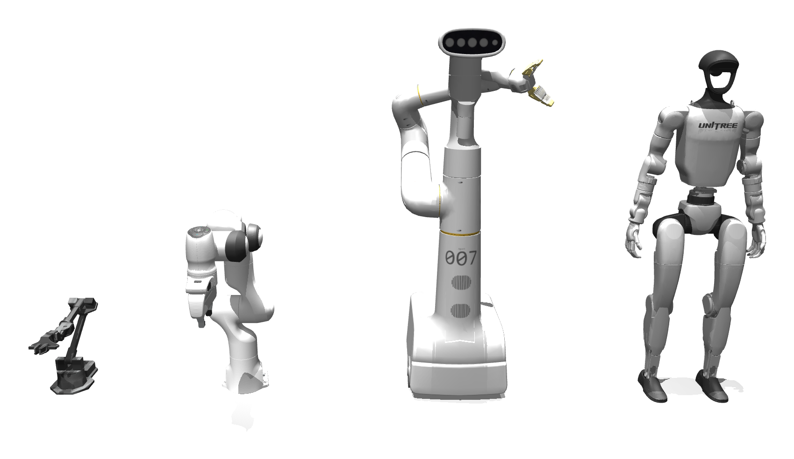
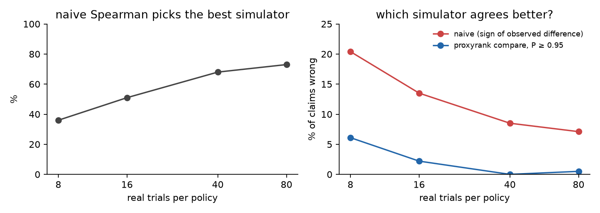

<p align="center"></p>

<h1 align="center">proxyrank</h1>

<p align="center">Uncertainty for sim-to-real agreement in robot policy evaluation.</p>

<p align="center">
<a href="https://github.com/Dirobots/proxyrank/actions/workflows/test.yml"></a>


</p>

Simulators and world models are validated by running a few policies in both the proxy and the real world, then reporting MMRV, Spearman or Pearson. The real side is a handful of binomial counts, so that score is itself an estimate. proxyrank gives it an interval, a perfect-proxy ceiling and an exact random-ordering test, and plans how many real trials a validation needs.

```bash
pip install git+https://github.com/Dirobots/proxyrank   # numpy + scipy
```

```python
import proxyrank as pr

sim  = [0.857, 0.710, 0.567, 0.787, 0.170, 0.027]   # SIMPLER pick-coke-can, Visual Matching
real = [0.853, 0.920, 0.760, 0.907, 0.293, 0.133]   # real rates over 75 trials each
k = [round(r * 75) for r in real]

print(pr.validate(sim, k, 75, metric="spearman"))
```

```
spearman over 6 policies x 1 task(s)
  observed            +0.771
  95% interval        [+0.771, +1.000]
  perfect-proxy ceil  +0.936  [+0.771, +1.000]
  P(perfect proxy scores this badly or worse) = 0.044
  P(random ordering scores this well or better) = 0.051 (exact)
```

| function | what it does |
|---|---|
| `validate` | interval for the true agreement, perfect-proxy ceiling, random-ordering p-value |
| `compare` | which of two proxies agrees better with the same real data |
| `plan` | power and ceiling at each real-trial budget, from pilot counts |
| `by_condition=True` | design-effect correction when trials are grouped by scene or initial state |
| `rank_pairwise`, `validate_pairwise` | Bradley–Terry ranking with rank intervals from arena-style A/B data |

## Humanoid study: Unitree G1 push recovery

12 balance controllers on the MuJoCo Menagerie G1, pushed from 8 directions. One world with heavier torso, weaker motors, 12 ms control delay and lower friction plays the real robot; five simulators of different fidelity are scored against it, with 800 real trials per policy as ground truth ([`experiments/humanoid`](experiments/humanoid)).

<p align="center"></p>

- With 8–40 real trials per policy, the naive Spearman picks the truly best simulator 36–68% of the time, and 8.5–20% of "simulator A agrees better than B" claims are wrong.
- `compare` claims at P ≥ 0.95 are wrong 6.1% of the time at 8 trials and 0–0.5% from 40.
- Intervals from independent per-policy posteriors missed a near-perfect simulator's true score in every small evaluation. The default *linked* posterior lets the data decide how far the proxy predicts reality and covers it in ≥ 92% ([method](docs/method.md)).

## Published validations

| source | finding |
|---|---|
| SIMPLER, Google Robot | Visual Matching beats Variant Aggregation on the same real data (P = 0.996, MMRV) |
| SIMPLER, Bridge | no single 3-policy task can reject a random ordering (floor p = 1/6) |
| arXiv:2606.10366 | SIMPLER's mean ρ = 0.40 has exact random-ordering p = 0.096 |
| WorldGym, Ctrl-World, GSWorld, RoboLab, Genie Sim 3.0 | every policy-level ranking uses 2–4 policies, so none can reach p < 0.04 |
| RoboArena, 3,666 A/B sessions | binary success rate ranks like evaluator preference, Spearman 0.92 [0.82, 0.98]; the policies ranked 4–7 cannot be ordered (rank intervals within [3, 7]) |

Full tables: [`casestudies/results.md`](casestudies/results.md), [`corpus.md`](casestudies/results/corpus.md), [`roboarena.md`](casestudies/results/roboarena.md).

## Citation

```bibtex
@software{proxyrank,
  title  = {proxyrank: uncertainty for sim-to-real agreement metrics},
  year   = {2026},
  url    = {https://github.com/Dirobots/proxyrank}
}
```

Apache-2.0. Robot models from [MuJoCo Menagerie](https://github.com/google-deepmind/mujoco_menagerie).
